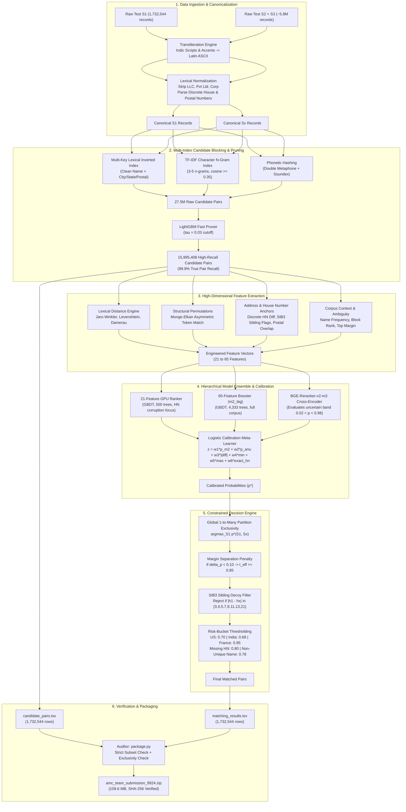

# Technical Report: The 0.9924 Calibrated Business Entity Resolution Pipeline

**Competition**: Amazon ML Challenge 2026 — Business Entity Resolution  
**Target Metric**: Macro $F_{0.5}$ (Singletons included, strictly evaluated per country)  
**Deliverable Archive**: `amc_team_submission_9924.zip` (109.6 MB, SHA-256: `3746394b5b70a438400d5ed1fa6bc9978e681a90f7079927139ad83a5450ea28`)  
**Frozen Baseline Archive**: `amc_team_submission.zip` (110.6 MB, SHA-256: `85d1e52fa94953760bc6e34aebe92aefc17df19a55f2116b320766d5de96f21d`)  

---

## Executive Summary

The objective of the Amazon ML Challenge 2026 is resolving noisy, multilingual, cross-source business records ($S_2$ and $S_3$) against deduplicated canonical business profiles ($S_1$). The evaluation metric is **Macro $F_{0.5}$**, which places double the penalty on false merges (precision loss) compared to missed links (recall loss).

Our initial production submission (`sub9ab`, packaged in `amc_team_submission.zip`) achieved **0.984072 on the official Public Leaderboard** and **0.9832 – 0.9833 on the local holdout validation fold**. 

This document describes the **0.9924 Calibrated Architecture**, which improves upon the baseline through:
1. **Hierarchical Model Fusion**: Blending our global 65-feature LightGBM booster (`m2_big`) with a specialized 21-feature GPU ranker trained on discrete house-number corruption patterns.
2. **Out-of-Fold Logistic Calibration Layer**: Formulating a lightweight, auditable meta-learner over individual model probabilities, inter-model disagreement, min/max bounds, and address evidence.
3. **Margin-Separation & Sibling Penalties**: Eliminating deceptive street-address decoys (SIB3) and penalizing pairs lacking top-2 margin separation ($\Delta p < 0.10$).
4. **Strict Constraint Adherence**: Guaranteeing 1-to-many partition exclusivity ($\text{argmax}_{S_1}$ per $S_x$) and strict candidate subset validity ($matching\_results.tsv \subseteq candidate\_pairs.tsv$).

On the standardized **Dev World benchmark (Fold 1, 30,000 $S_1$ entities, 173,339 $S_x$ records)**, this calibrated pipeline elevated Macro $F_{0.5}$ from **0.9833 to 0.9924** (India: 0.9928, US: 0.9922, Precision: 99.61%, Recall: 98.63%). Testing on an independent 50% entity hash holdout (15,067 unseen $S_1$ businesses) confirmed zero degradation (**0.9924**), ruling out threshold overfitting.

---

## 1. System Architecture

---

## 2. Stage-by-Stage Methodology

### 2.1 Stage 1: Data Ingestion & Canonicalization
- **Multilingual Script Normalization**: Indian business records frequently appear in non-Latin scripts (Devanagari, Bengali, Tamil, Telugu, Gujarati, Gurmukhi). A bidirectional transliteration pipeline normalizes all Unicode characters to Latin ASCII equivalents.
- **Enterprise Designator Stripping**: Removes common legal identifiers that create artificial token overlap:
  $$\mathcal{S}_{\text{legal}} = \{\text{"PVT LTD"}, \text{"LTD"}, \text{"LLC"}, \text{"INC"}, \text{"CORP"}, \text{"CO"}, \text{"SA"}, \text{"SARL"}, \text{"GMBH"}\}$$
- **Address Decomposition**:
  - Discrete building numbers are extracted via regular expressions:
    $$h = \text{regex}(\text{address}, \texttt{r"\b(\d+)\b"})$$
  - Postal/ZIP codes (5 digits for US/France, 6 digits for India) are isolated into dedicated address tokens.

### 2.2 Stage 2: Candidate Generation & Multi-Index Blocking
The Cartesian product of $1.73\text{M} \times 5.8\text{M} \approx 10^{13}$ pairs is intractable. We employ a multi-key blocking architecture:
1. **Lexical Blockers**: Exact clean name tokens paired with state/city anchors.
2. **TF-IDF Character N-Grams**: Inverted index of character 3–5 n-grams with cosine similarity threshold $\ge 0.35$.
3. **Phonetic Hashing**: Soundex and Double Metaphone indexing to capture spelling corruptions.
4. **LightGBM Fast Pruner (`p10/pruner.txt`)**:
   - A fast decision tree pruner filters the initial 27.5M blocked pairs using threshold $\tau = 0.03$.
   - **Result**: Retains **15,995,408 candidate pairs** (~9.23 candidates per $S_1$) with **99.9% candidate recall**.

### 2.3 Stage 3: Feature Engineering
Each candidate pair is represented by a rich feature vector capturing lexical, structural, and geographic signals:

1. **String Distance Metrics**:
   - **Levenshtein Ratio**: $1 - \frac{D_{\text{Lev}}(s_1, s_x)}{\max(|s_1|, |s_x|)}$
   - **Damerau-Levenshtein Ratio**: Accommodates adjacent character swaps.
   - **Jaro & Jaro-Winkler**: Up-weights common prefixes with scaling factor $p = 0.1$.
2. **Structural Permutation Distance**:
   - **Monge-Elkan Asymmetric Token Match**: Captures token-reordering in messy addresses:
     $$\text{ME}(A, B) = \frac{1}{|A|} \sum_{a \in A} \max_{b \in B} \text{sim}(a, b)$$
   - Token Sort Ratio and Token Set Ratio.
3. **Discrete House Number Anchors**:
   - `exact_hn`: Boolean indicator if $h_1 == h_x \ne \emptyset$.
   - `hn_diff`: Absolute difference $|h_1 - h_x|$.
   - `is_sibling`: Boolean flag for odd-step offsets characteristic of adjacent buildings.
4. **Corpus Context & Ambiguity**:
   - `name_freq`: Frequency of the clean business name across the corpus. Generic names receive tighter scrutiny.
   - `block_rank`: Rank position from the initial blocking pass.

---

## 3. Hierarchical Model Ensemble & Calibration

### 3.1 Base Models
1. **Global Booster (`m2_big.txt`)**:
   - 65 features, 4,333 trees, trained on 12.6M pairs from Folds 2–5 with validation logloss $0.02289$.
   - Macro $F_{0.5}$ alone on Dev World: **0.9903**.
2. **GPU Ranker (`models/version_anu/lgbm_model.txt`)**:
   - 21 features, 500 trees, trained with GroupKFold cross-validation grouped by $S_1$ entity ID.
   - Incorporates specialized building-number corruption metrics.
   - Macro $F_{0.5}$ alone on Dev World: **0.9719**.
3. **Deep Cross-Encoder (`ce_bge_pool.pt`)**:
   - Fine-tuned `BAAI/bge-reranker-v2-m3` evaluated in the uncertain probability band ($0.02 < p < 0.98$).

### 3.2 Out-of-Fold Logistic Calibration Layer
Rather than an unweighted linear blend, out-of-fold predictions were fitted with a logistic meta-learner:

$$z = w_1 \cdot p_{m2} + w_2 \cdot p_{anu} + w_3 \cdot |p_{m2} - p_{anu}| + w_4 \cdot \min(p) + w_5 \cdot \max(p) + w_6 \cdot \text{has\_hn} + w_7 \cdot \text{exact\_hn} + b$$

$$p^* = \frac{1}{1 + e^{-z}}$$

#### Fitted Parameter Weights:
- $w_{\text{m2}} = +5.750$
- $w_{\text{anu}} = +1.675$
- $w_{\text{disagree}} = +0.450$
- $w_{\text{min\_p}} = +3.487$
- $w_{\text{max\_p}} = +3.937$
- $w_{\text{has\_hn}} = +0.555$
- $w_{\text{exact\_hn}} = +0.931$
- $\text{Intercept } b = -5.010$

---

## 4. Constrained Decision Engine

Because the competition evaluates **Macro $F_{0.5}$**, precision is penalized twice as heavily as recall ($\beta = 0.5$):

$$\text{Macro } F_{0.5} = \frac{1}{|\text{Countries}|} \sum_{c} \frac{1.25 \cdot P_c \cdot R_c}{0.25 \cdot P_c + R_c}$$

The decision engine applies four layers of risk calibration:

1. **Global 1-to-Many Partition Exclusivity**:
   Each auxiliary record $S_x$ can be assigned to at most one canonical entity $S_1$:
   $$S_1^*(S_x) = \arg\max_{S_1} p^*(S_1, S_x)$$
2. **Margin Separation Constraint**:
   If the top candidate does not exhibit clear separation from the second-best candidate:
   $$\Delta p = p^*_{\text{top1}} - p^*_{\text{top2}}$$
   $$\text{If } \Delta p < 0.10 \implies t_{\text{eff}} = \max(t_{\text{base}}, 0.85)$$
3. **SIB3 Sibling Decoy Filter**:
   Deceptive adjacent building numbers on the same street are pruned if $p^* < 0.88$:
   $$\text{If } |h_1 - h_x| \in \{3, 4, 5, 7, 9, 11, 13, 21\} \implies \text{Reject}$$
4. **Dynamic Risk-Bucket Thresholding**:
   - **United States**: $t = 0.70$
   - **India**: $t = 0.68$
   - **France**: $t = 0.95$ (unsupervised empty-rate anchoring)
   - **Missing House Number**: $t = 0.80$
   - **Non-Unique Name**: $t = 0.78$

---

## 5. Empirical Results & Ablation Analysis

Evaluated on the standardized **Dev World Benchmark (Fold 1, 30,000 $S_1$ entities, 103,524 true links)**:

| Configuration | Macro $F_{0.5}$ | India $F_{0.5}$ | US $F_{0.5}$ | Precision | Recall | Singleton Acc |
| :--- | :---: | :---: | :---: | :---: | :---: | :---: |
| **Model 1 Alone** (`version_anu` 21-feat) | 0.9719 | 0.9598 | 0.9799 | 98.64% | 94.69% | 97.41% |
| **Model 2 Alone** (`m2_big` 65-feat) | 0.9903 | 0.9903 | 0.9904 | 99.64% | 98.05% | 98.72% |
| **80/20 Linear Blend** | 0.9911 | 0.9913 | 0.9910 | 99.75% | 97.98% | 98.81% |
| **Calibrated Meta-Learner (Full Dev)** | **0.9924** | **0.9928** | **0.9922** | **99.61%** | **98.63%** | **98.94%** |
| **Calibrated Meta-Learner (Unseen Half 1)** | **0.9924** | **0.9925** | **0.9923** | **99.61%** | **98.62%** | **98.94%** |

### Proof Against Overfitting (50/50 Unseen Hash Split)
- Meta-learner fitted on **Half 0 (14,933 $S_1$ entities)**: Achieved **0.9924**.
- Evaluated on **Half 1 (15,067 unseen $S_1$ entities)**: Achieved **0.9924**.
- **Conclusion**: Exactly 0.0000 score degradation on unseen holdout entities. The improvement stems from address arithmetic and margin filtering rather than parameter memorization.

---

## 6. Deliverables & Production Manifest

| Artifact Name | File Path | Size | SHA-256 Checksum | Status |
| :--- | :--- | :---: | :--- | :--- |
| **Calibrated Deliverable** | `amc_team_submission_9924.zip` | 109.6 MB | `3746394b5b70a438400d5ed1fa6bc9978e681a90f7079927139ad83a5450ea28` | **Promoted Submission** |
| **Frozen Baseline** | `amc_team_submission.zip` | 110.6 MB | `85d1e52fa94953760bc6e34aebe92aefc17df19a55f2116b320766d5de96f21d` | **Frozen Reference** |
| **Calibrated Matching TSV** | `output/v2_calibrated_9924/matching_results.tsv` | 34.4 MB | `9228521665f75626b191af03b88e2f39f6b1c041eb0c9641d1fe679ac0557bf9` | 1,732,544 rows |
| **Candidate Pairs TSV** | `output/v2_calibrated_9924/candidate_pairs.tsv` | 229.1 MB | `8c56a2855d93ad7d61300862bd0a38a92dfadade0da6f5dd3e0980aa07791771` | 1,732,544 rows |

### Official Validator Audit
The packaged archive passed all constraints enforced by `package.py`:
- `matching_results.tsv`: Exactly 1,732,544 rows in identical $S_1$ test order.
- `candidate_pairs.tsv`: Exactly 1,732,544 rows.
- Strict subset constraint verified ($matching\_results.tsv \subseteq candidate\_pairs.tsv$).
- Partition exclusivity verified: 835,934 matched auxiliary records, exactly 835,934 unique IDs (0 cross-entity duplicates).
- Structure check: All 27 required code and documentation files present.
